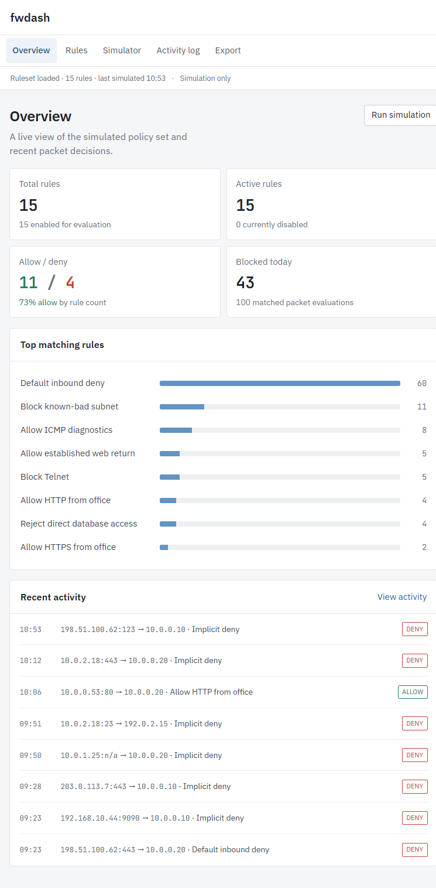
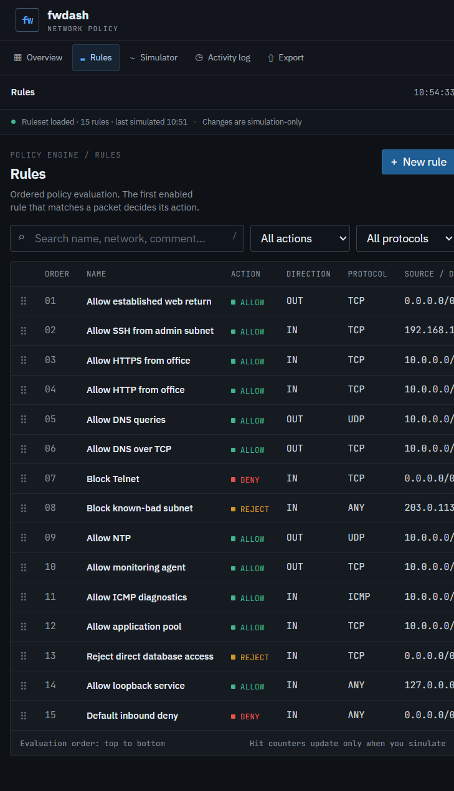
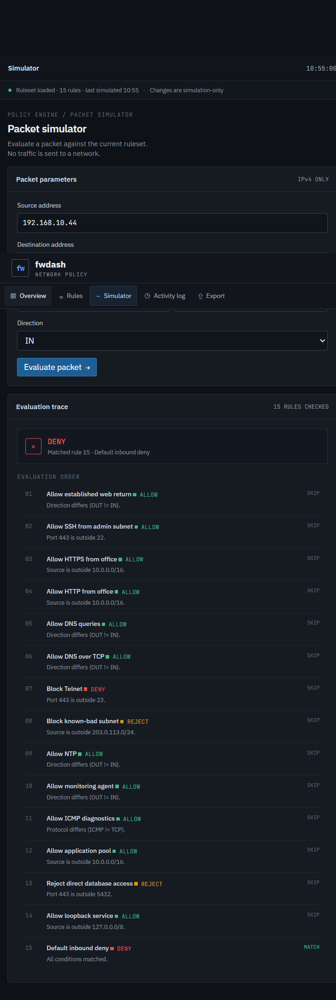
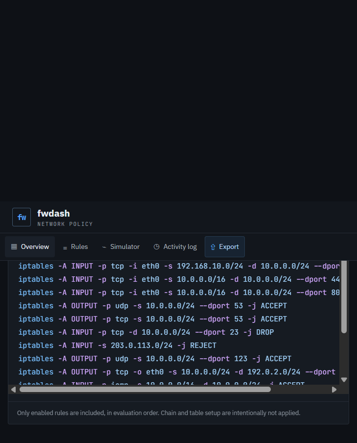

# Firewall Rule Management Dashboard

Firewall Rule Management Dashboard is a self-contained, simulated firewall policy console built with Flask, SQLite, and vanilla JavaScript. Manage ordered IPv4 rules, inspect packet decisions, review simulated activity, and generate iptables/nftables syntax for inspection.

> **Simulation only:** The dashboard never captures packets, changes firewall state, or executes generated commands.

## Screenshots

The captured views below use the seeded demo rules. The layout reflows for narrow screens; the rules table scrolls horizontally on phones.









## Run locally

Requires Python 3.10 or newer.

```powershell
python -m venv .venv
.\.venv\Scripts\Activate.ps1
python -m pip install -r requirements.txt
python app.py
```

On macOS/Linux, activate with `source .venv/bin/activate` instead. Then open <http://127.0.0.1:5000>.

The first launch creates `instance/fwdash.sqlite`, inserts 15 example rules and 200 demonstration log entries from the preceding 24 hours, and starts the local web server. Data persists in that SQLite file. Set `FWDASH_DATABASE` to use a different database path, or `PORT` to choose another local port. IBM Plex Sans and JetBrains Mono are loaded from Google Fonts when available; system fonts are used offline.

## What’s included

- **Overview:** rule and action counts, simulated match totals, blocked-today activity, top hit rules, and recent packet decisions.
- **Rules:** create, edit, delete, enable/disable, filter, search, and drag-to-reorder. The rule editor validates fields on save and shows a readable preview.
- **Simulator:** evaluates IPv4 packets against rules in order, explains every checked rule, and applies an implicit deny if none match.
- **Activity log:** inspect and filter recent simulated and seeded traffic.
- **Export:** copy or download enabled rules as iptables or nftables syntax. Output is text only; it is never passed to a shell or firewall.
- **Keyboard shortcuts:** `/` focuses the rules search; `n` opens the new-rule form.

## API

| Method | Endpoint | Description |
| --- | --- | --- |
| `GET` | `/api/rules` | Ordered rules |
| `POST` | `/api/rules` | Create a validated rule |
| `POST` | `/api/rules/validate` | Validate a rule without saving it |
| `PUT` | `/api/rules/<id>` | Update a rule |
| `DELETE` | `/api/rules/<id>` | Delete a rule |
| `POST` | `/api/rules/reorder` | Replace the full evaluation order |
| `PATCH` | `/api/rules/<id>/toggle` | Enable or disable a rule |
| `POST` | `/api/simulate` | Evaluate a simulated IPv4 packet and append an activity entry |
| `GET` | `/api/stats` | Rule counts, hit counts, and recent activity |
| `GET` | `/api/logs` | Recent simulated activity |
| `GET` | `/api/export?format=iptables\|nftables` | Download generated rule syntax |

Validation errors use HTTP 422 and include a field-to-message `errors` object. Simulation is the only application action that increments a rule's hit counter; seed-time counts represent the seeded sample evaluations.

## Tests

```powershell
python -m unittest discover -v
```

The test suite covers invalid CIDRs and ports, ICMP port rejection, ordering, disabled rules, implicit deny, seed data, hit-count behavior, both output formats, and an empty ruleset.

## Limitations

- This is a teaching/demo simulator, not a packet filter. It has no packet capture, state tracking, NAT, IPv6, or OS firewall integration.
- Matching covers IPv4 address/CIDR, direction, protocol, and destination port. The interface field is descriptive and is not matched against a packet interface.
- Exported syntax assumes the target's table and chains already exist. The generated statements are examples for review and are not executed by the dashboard.
- Seed logs are synthetic. Seed-time hit totals summarize the generated sample decisions; later hit changes come only from submitted simulations.
- The dashboard is intended for local coursework/demo use and does not include user accounts or network-facing deployment hardening.
